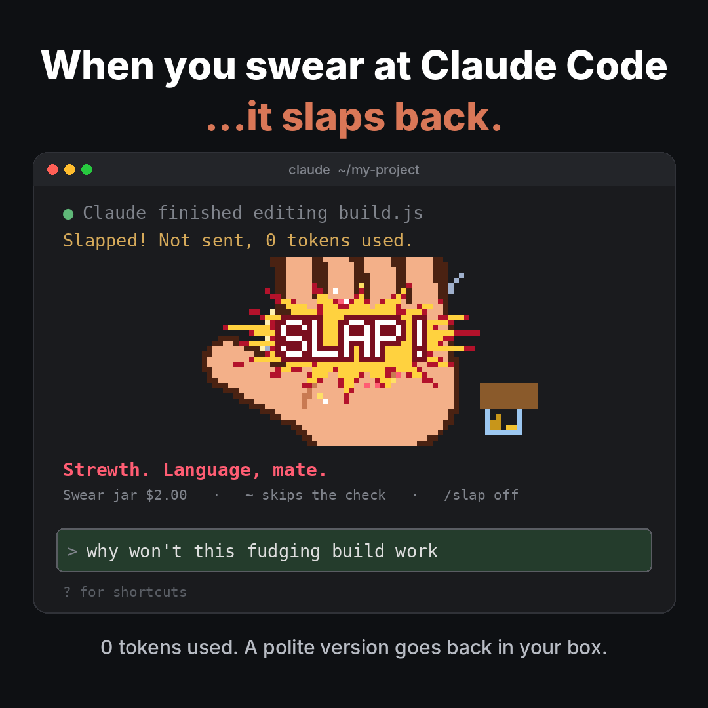

# Swear Slap

**Swear at Claude Code and a cartoon hand slaps back.**




https://github.com/user-attachments/assets/4dcbbd78-c00d-4c83-b42f-4f90b8ea6694


[](LICENSE)


Type a swear word in a message to Claude and, instead of sending it:

1. A pixel-art hand winds up, swings and **slaps** the strip above your prompt. The screen flashes, SLAP! pops, the glass cracks, stars spin round the handprint and a coin drops in the swear jar.
2. **Your message is not sent**, so Claude never sees it and it costs nothing.
3. **A polite version goes back in your prompt box** ("why won't this *fudging* build work"), so you can press Enter and carry on.

It's a bit of fun, and a gentle nudge to keep your prompts clean.

## Install

You need Claude Code **2.1.287 or newer** (check with `claude --version`, update with `claude update`). Built and tested on 2.1.296.

In Claude Code, run:

```
/plugin install swear-slap --marketplace paragpandyareal/swear-slap
```

Then run `/reload-plugins` (or restart Claude Code). That's it: no Python, no packages, no settings to change.

Check it's on with `/slap`. It answers with the jar total and the commands.

## Using it

| Do this | What happens |
| --- | --- |
| Swear in a message | Slap. The message is not sent and a polite version goes back in your prompt box |
| Start a message with `~ ` | Skips the check once; the `~ ` is removed before sending. Handy for quoting someone else's rude error message |
| `/slap off` | Pauses the slap until you turn it back on |
| `/slap on` | Arms it again |
| `/slap jar` (or just `/slap`) | Shows the swear jar total |
| `/slap reset` | Empties the jar |
| `/slap sound test` | Plays the slap sound now and tells you what it detected |
| `/slap sound off` | Mutes the sound. `/slap sound auto` brings it back; `/slap sound bell` always uses the terminal bell |

Words inside a code block (three backticks) or in pasted text are never checked, so you won't get slapped for words you didn't write. `!` is left alone because Claude Code uses it for shell commands.

## Sound

The sound plays by itself, with nothing to set up, wherever Claude Code runs on your own computer:

| Where Claude Code runs | What plays the slap |
| --- | --- |
| Mac | Claude Code's own player |
| Windows | Windows' built-in PowerShell sound player |
| Linux desktop | `paplay`, or `aplay` if that's missing (one of them comes with almost every desktop) |
| A server over SSH | Your terminal's bell (see below) |

**Over SSH:** the sound has to play on your computer, but Claude Code is running on the server, and the terminal bell is the only sound that travels back over SSH. Two one-time steps:

1. In Claude Code, open `/config`, find **Notifications** and set it to **Terminal Bell**. (Side effect: Claude Code also rings the bell when it finishes a task or needs you.)
2. In your terminal, make sure the bell is audible. You'll hear your terminal's normal bell. For the real slap sound instead, point your terminal's bell sound at `sounds/slap.wav` from this repository. In Windows Terminal that's **Settings → your profile → Advanced → Bell notification style: Audible**, then add `"bellSound": "C:/path/to/slap.wav"` to that profile in the settings file.

Run `/slap sound test` at any point. It says what it found, for example *"Detected a server (bell over SSH), sound auto. Rang your terminal bell (terminal_bell)."*, or what to fix if it couldn't.

## Change the words

Open `hooks/words.ts` in the installed plugin (or your own copy). Each line is a word pattern and its polite swap. Delete a line to allow a word (Aussies may want to free up "bloody"), or copy a line to add one. Save, then run `/reload-plugins`.

Patterns match whole words only, so "class", "assess" and "Scunthorpe" never trip it.

The roast lines are in `ROASTS` at the top of `hooks/register.ts`, and the price per swear is `CENTS_PER_SWEAR` (50 cents).

## Limits and known issues

- **The animation lives in the strip above your prompt**, the only place Claude Code lets a mod draw. In Claude Code's fullscreen layout that strip is at most half the window; on the normal layout the slap takes up to 60% of the terminal. A bigger window gives a bigger, sharper slap.
- **The animation is terminal only.** In the Claude desktop app you still get blocked and roasted, as text.
- **Pixel art in a terminal is made of block characters**, so it's chunky by nature. Colours are chosen to show exactly in 256-colour terminals too.
- **The impact is a bright flash** (about a tenth of a second, white then red). If flashes bother you, use `/slap off`.
- **Windows sound** uses PowerShell, which can take a moment to start; the mod starts it early so the sound lands on the slap. It's the least-tested path so far. If it stays quiet, run `/slap sound test` and open an issue with what it says.
- It checks English swear words only (see `hooks/words.ts`).

## Troubleshooting

| Problem | Fix |
| --- | --- |
| `/slap` isn't there after installing | Run `/reload-plugins` or restart Claude Code. Check `/plugin` lists `swear-slap` as enabled |
| No slap when I swear | Run `/slap` to see if it's paused (`/slap on` arms it). Messages from scheduled tasks and other sessions are never checked, only what you type |
| It slapped a word I didn't mean as a swear | Start the message with `~ `, or delete that word's line in `hooks/words.ts` |
| No sound | Run `/slap sound test` and follow what it says. Over SSH, see **Sound** above |
| `/slap sound test` says *no-channel* | Claude Code doesn't know how to ring your terminal's bell. Set `/config` → Notifications → **Terminal Bell** |
| `sound` doesn't show in the command list | It's a word after `/slap`, not its own command. Type `/slap sound test` in full |

## Permissions and data

What the mod does on your computer, in full:

- **Reads the message you're about to send**, only to look for swear words, and either lets it through untouched or stops it. If anything goes wrong inside the mod, your message goes through as normal.
- **Fills your prompt box** with the polite version after a slap.
- **Draws** the animation in the strip above the prompt and shows a line of text under it.
- **Plays a sound**, as described under **Sound**: Claude Code's own player on Mac; on Windows it runs `powershell.exe` with a fixed script; on Linux it runs `sh` with a fixed script that calls `paplay` or `aplay` and uses one temporary file it deletes straight after. Over SSH it asks Claude Code to ring the terminal bell. Once per session it runs `uname -s` to tell Mac from Linux. The only data these programs receive is the bundled sound.
- **Reads three environment variables**: `OS` (is this Windows?), `DISPLAY` and `WAYLAND_DISPLAY` (does this Linux machine have a screen?). It reads no credentials.
- **Keeps four values** in Claude Code's own plugin storage: the swear jar total, the slap count, whether the slap is on, and your sound choice.
- **Never** makes network requests, reads your files or conversation, writes files (apart from that temporary sound file on Linux), or sends anything anywhere.

### Notes for the directory review

| Finding | Answer |
| --- | --- |
| Starts programs (`process.run`) | Only to play the sound and to tell the OS apart: `uname -s`, `powershell.exe` with a fixed script, or `sh` with a fixed script. Every argument is fixed text in `hooks/register.ts`; nothing from the user or the conversation is passed. Standard input is the bundled sound (base64, `hooks/sound.ts`). |
| Hooks `prompt.submit` (can stop a prompt) | That is the purpose: a message with a swear word is stopped and a polite version is put back in the prompt box for the person to send. The hook has a `.catch` that passes the prompt on unchanged. |
| Fills the prompt (`prompt.fill`) | Only with the person's own message, swear words swapped for polite ones. It is never submitted for them. |
| Rings a notification (`ui.notify`) | Only for the sound over SSH (the terminal bell), and only when a slap happens or on `/slap sound test`. |
| Reads environment variables | `OS`, `DISPLAY`, `WAYLAND_DISPLAY` only, to choose a sound player. |

## Uninstall

```
/plugin uninstall swear-slap
/plugin marketplace remove swear-slap
```

Then `/reload-plugins`. If you set Notifications to Terminal Bell only for this, you can set it back in `/config`.

## Privacy

Swear Slap collects nothing and sends nothing anywhere. See [PRIVACY.md](PRIVACY.md).

## Files

- `hooks/register.ts`: catches the message, runs the slap, the `/slap` command, the swear jar and the sound
- `hooks/art.ts`: draws every animation frame as pixels
- `hooks/words.ts`: the swear list and polite swaps
- `hooks/sound.ts`: the slap sound, embedded so Windows and Linux can play it
- `hooks/slap.test.ts`: tests, run with `claude plugin test .`
- `sounds/slap.wav`: the slap sound

## Support

Found a bug or have an idea? [Open an issue](https://github.com/paragpandyareal/swear-slap/issues). For a security problem, see [SECURITY.md](SECURITY.md).

## License

[MIT](LICENSE) © 2026 Parag Pandya. Use it, change it, share it; keep the copyright notice.
